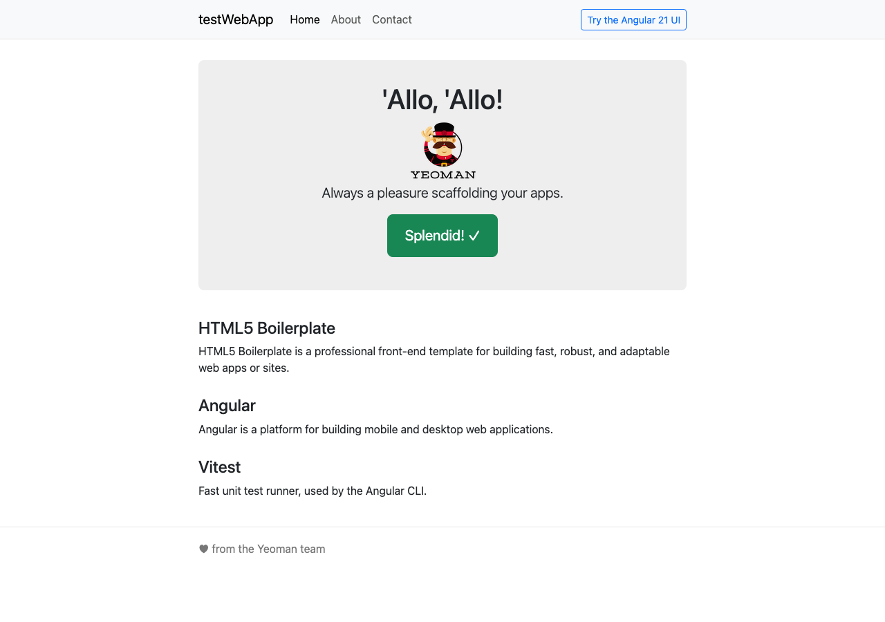
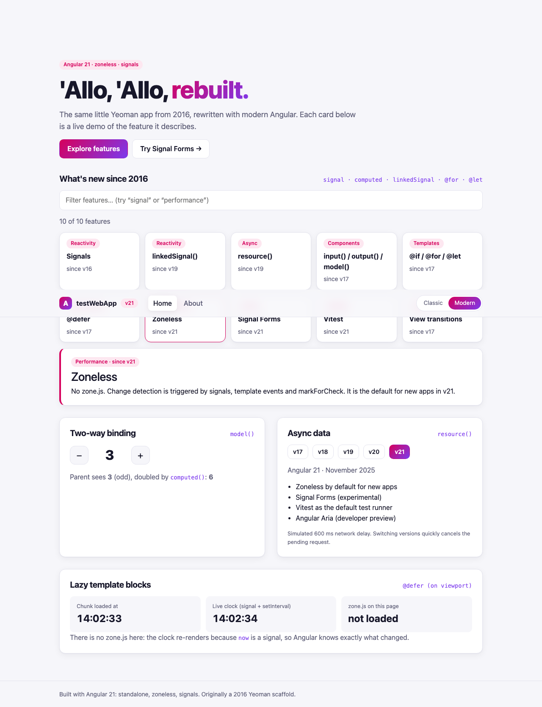

# test-web-app

A small Angular app with Home and About pages and a notes form.

Originally scaffolded in 2016 with [generator-angular](https://github.com/yeoman/generator-angular) 0.15.1
(AngularJS 1.4, Bower, Grunt, Karma/PhantomJS) and migrated in 2026 to Angular 21
(standalone components, signals, zoneless change detection, Bootstrap 5, Vitest).

## Two UIs

A switch in the header (saved in localStorage) toggles between:

- **Classic**: the original 2016 Yeoman/Bootstrap look, ported 1:1.
  
  
- **Modern** (default): a redesign with live demos of Angular 21 features: signals, `computed`,
  `linkedSignal`, `resource()`, `input()`/`output()`/`model()`, `@let`, `@defer`, zoneless change detection,
  router view transitions, and notes built with the experimental **Signal Forms** (`form()`, `[formField]`, `submit()`).
  
  


## Requirements

- Node.js `^20.19`, `^22.12` or `>=24`
- npm

## Development

```bash
npm install
npm start          # dev server at http://localhost:4200
```

## Build

```bash
npm run build      # output in dist/test-angular-yeo/browser
```

## Testing

```bash
npm test           # Vitest in watch mode
npm run test:ci    # single run (used by Jenkins)
```

## Project layout

```
src/
  app/
    app.ts / app.html        # shell: classic or modern header + router outlet + footer
    ui-mode.ts               # UiMode service: which UI is shown (signal + localStorage)
    app.routes.ts            # lazy routes: '' -> HomePage, 'about' -> AboutPage
    pages/                   # route components that pick the classic or modern page
    classic/                 # original UI (former MainCtrl, AboutCtrl, <my-note-directive>)
    modern/                  # Angular 21 showcase (home demos, Signal Forms notes, ...)
  styles.css                 # Bootstrap 5 + classic theme
  modern.css                 # modern theme, scoped under .m-app (light + dark)
public/                      # static assets (images, favicon, robots.txt)
```
